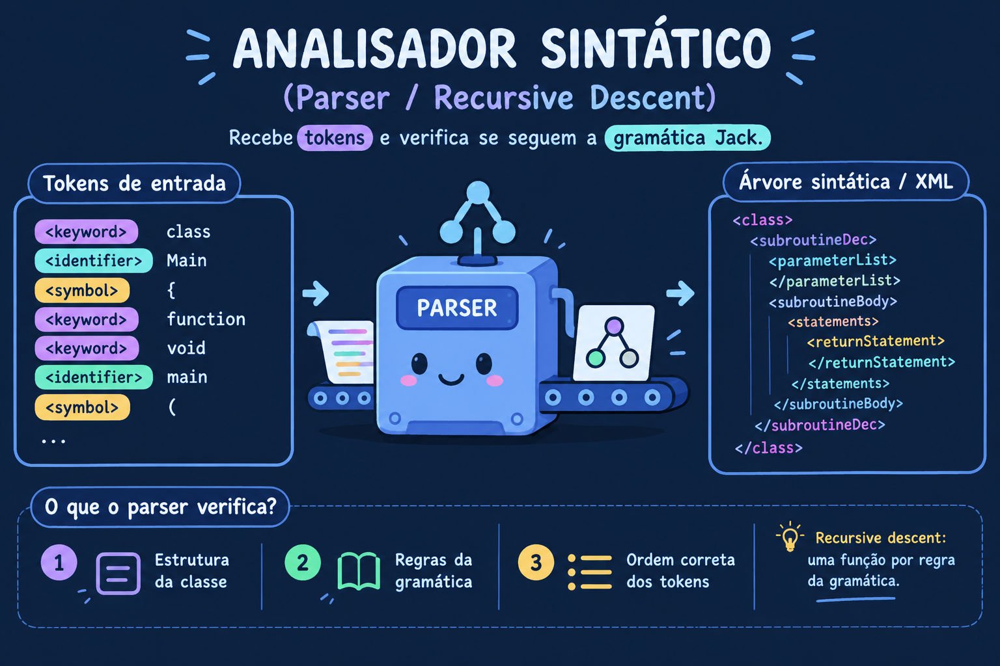

# jackcompiler

Compilador para a linguagem **Jack**, desenvolvido na disciplina de Compiladores (UFMA).
Analisador léxico (scanner) e analisador sintático (parser por *recursive descent*), com saída em XML validada contra os arquivos oficiais do Nand2Tetris.

<p align="center">
  
  
</p>

## 👥 Integrantes

* Irlanda Hildeney Oliveira Teixeira — 20250013345
* Isaque Mendonça Costa — 20250042641

## ⚙️ Tecnologias

* **Linguagem:** Java (JDK 11 ou superior)
* **Testes:** JUnit 5 (Platform Console Standalone 1.12.0, baixado localmente — não versionado)
* **Saída:** XML

## 📁 Estrutura

```text
jackcompiler/
├── assets/                # GIF e PNG usados neste README
├── examples/              # Programas Jack de entrada (Main, Square, SquareGame)
├── lib/                   # JAR do JUnit (baixado manualmente, ignorado pelo Git)
├── src/                   # Código-fonte do compilador
│   ├── JackTokenizer.java # Scanner
│   ├── Token.java / TokenType.java
│   ├── CompilationEngine.java  # Parser (uma função por não-terminal)
│   ├── XmlWriter.java
│   └── Main.java
├── test/
│   ├── expected_xml/      # XMLs oficiais do Nand2Tetris (*T.xml = tokens; demais = árvore sintática)
│   ├── LexerTest.java
│   └── ParserTest.java
├── bin/ e output/         # gerados (ignorados pelo Git)
├── .gitignore / .gitattributes
└── README.md
```

## 🚀 Como compilar e executar

Todos os comandos são executados **na raiz do projeto** e usam caminhos relativos.

**1. Baixar o JUnit (uma vez)** — funciona em Linux, macOS e Windows 10+:

```
curl -L -o lib/junit-platform-console-standalone-1.12.0.jar https://repo1.maven.org/maven2/org/junit/platform/junit-platform-console-standalone/1.12.0/junit-platform-console-standalone-1.12.0.jar
```

**2. Compilar** (classes vão para `bin/`; não há separador de classpath, então o comando é igual em qualquer sistema):

```
javac -encoding UTF-8 -d bin -cp lib/junit-platform-console-standalone-1.12.0.jar src/*.java test/*.java
```

**3. Gerar o XML sintático** (parser). Se o nome de saída for omitido, é gerado `output/saida.xml`:

```
java -cp bin Main examples/Main.jack output/Main.xml
```

**4. Gerar o XML de tokens** (scanner), com a flag `--lexer`:

```
java -cp bin Main examples/Main.jack output/MainT.xml --lexer
```

> Nome do arquivo de saída: livre, escolhido na linha de comando. A pasta `output/` é criada automaticamente.

## 🧪 Testes automatizados

São 6 testes JUnit: `LexerTest` (3) compara os tokens com `MainT.xml`, `SquareT.xml` e `SquareGameT.xml`; `ParserTest` (3) compara a árvore com `Main.xml`, `Square.xml` e `SquareGame.xml`. As entradas estão em `examples/` e os XMLs de referência em `test/expected_xml/`. A comparação ignora diferenças de indentação (`strip` em cada linha).

```
java -jar lib/junit-platform-console-standalone-1.12.0.jar execute --class-path bin --scan-class-path
```

### Resultado

**6 testes encontrados, 6 bem-sucedidos, 0 falhas**.

| Classe | Teste | Compara com | Resultado |
| --- | --- | --- | --- |
| `LexerTest` | `testMainTokens` | `MainT.xml` | ✅ |
| `LexerTest` | `testSquareTokens` | `SquareT.xml` | ✅ |
| `LexerTest` | `testSquareGameTokens` | `SquareGameT.xml` | ✅ |
| `ParserTest` | `testMainJack` | `Main.xml` | ✅ |
| `ParserTest` | `testSquareJack` | `Square.xml` | ✅ |
| `ParserTest` | `testSquareGameJack` | `SquareGame.xml` | ✅ |

Saída do comando:

```text
.
+-- JUnit Platform Suite [OK]
+-- JUnit Jupiter [OK]
| +-- LexerTest [OK]
| | +-- testMainTokens() [OK]
| | +-- testSquareTokens() [OK]
| | '-- testSquareGameTokens() [OK]
| '-- ParserTest [OK]
|   +-- testMainJack() [OK]
|   +-- testSquareGameJack() [OK]
|   '-- testSquareJack() [OK]
'-- JUnit Vintage [OK]

Test run finished after 1238 ms
[         6 tests found           ]
[         0 tests skipped         ]
[         6 tests started         ]
[         0 tests aborted         ]
[         6 tests successful      ]
[         0 tests failed          ]
```

Os XMLs de referência usados na comparação ficam em `test/expected_xml/`; a validação roda logo após clonar o repositório, seguindo os passos acima.


## 📐 Gramática

Recursive descent com uma função por não-terminal em `CompilationEngine`. Gramática Jack implementada (Apêndice A do livro):

```text
class:           'class' className '{' classVarDec* subroutineDec* '}'
classVarDec:     ('static'|'field') type varName (',' varName)* ';'
type:            'int' | 'char' | 'boolean' | className
subroutineDec:   ('constructor'|'function'|'method') ('void'|type) subroutineName '(' parameterList ')' subroutineBody
parameterList:   ((type varName) (',' type varName)*)?
subroutineBody:  '{' varDec* statements '}'
varDec:          'var' type varName (',' varName)* ';'
statements:      statement*
statement:       letStatement | ifStatement | whileStatement | doStatement | returnStatement
letStatement:    'let' varName ('[' expression ']')? '=' expression ';'
ifStatement:     'if' '(' expression ')' '{' statements '}' ('else' '{' statements '}')?
whileStatement:  'while' '(' expression ')' '{' statements '}'
doStatement:     'do' subroutineCall ';'
returnStatement: 'return' expression? ';'
expression:      term (op term)*
term:            integerConstant | stringConstant | keywordConstant | varName
               | varName '[' expression ']' | subroutineCall | '(' expression ')' | unaryOp term
subroutineCall:  subroutineName '(' expressionList ')'
               | (className|varName) '.' subroutineName '(' expressionList ')'
expressionList:  (expression (',' expression)*)?
op:              '+' | '-' | '*' | '/' | '&' | '|' | '<' | '>' | '='
unaryOp:         '-' | '~'
keywordConstant: 'true' | 'false' | 'null' | 'this'
```

Em Jack, `expression` é uma sequência `term (op term)*` avaliada da esquerda para a direita, sem precedência entre operadores (a ordem é explicitada com parênteses).

## 💡 Decisões de projeto

* **Lookahead no scanner:** `peekNext()` distingue o operador `/` dos comentários `//` e `/* */` sem consumir o caractere.
* **API de tokens:** `JackTokenizer` expõe `peek()` e `advance()`; o `CompilationEngine` usa também `match()` e `consume()`.
* **Fidelidade ao Nand2Tetris:** nomes de tags idênticos aos oficiais (ex.: `<letStatement>`) e escape de `&lt;`, `&gt;`, `&amp;` e `&quot;`.
* **Organização:** classes compiladas em `bin/` e saídas em `output/`, ambos fora do Git; JUnit baixado por comando, sem versionar o JAR.
* **Fim de linha:** `.gitattributes` normaliza para LF, evitando diferenças entre Windows e Linux.

## ⚠️ Limitações conhecidas

* Erros sintáticos são *fail-fast*: a compilação para na primeira exceção.
* Nem todas as mensagens de erro do parser informam a linha (algumas, como "Esperado static ou field" e "Termo inesperado", não informam), e nenhuma informa a coluna.
* Cada execução processa um único arquivo `.jack` (não há modo para diretório).
* Não há análise semântica (tabela de símbolos, verificação de tipos ou de declaração de variáveis); previsto para as próximas unidades.


