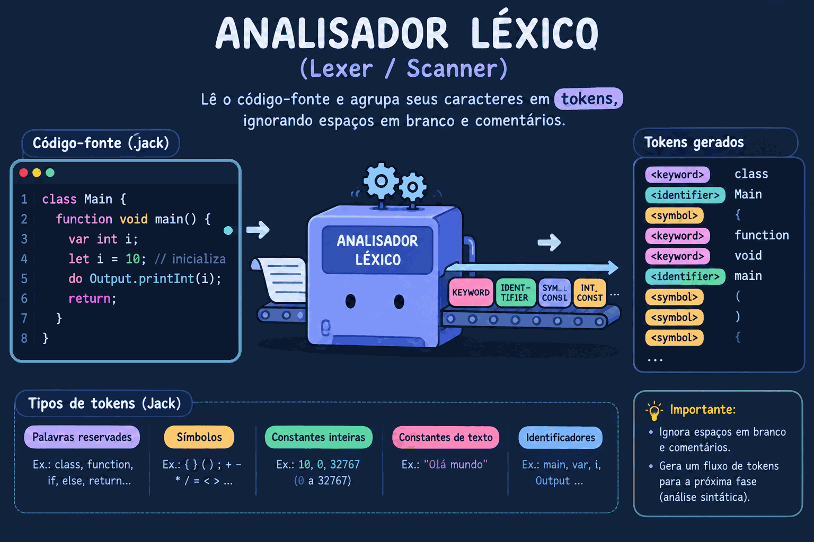

# Analisador Léxico e Sintático da Linguagem Jack

    
<p align="center">
    
  
</p>

## Integrantes

* **Irlanda Hildeney Oliveira Teixeira - 20250013345**
* **Isaque Mendonça Costa - 20250042641**

**Disciplina:** Compiladores

## Descrição do projeto

O projeto é dividido em duas etapas principais:
1. **Analisador Léxico (Lexer):** Lê o código-fonte de um arquivo `.jack`, ignora espaços e comentários, e classifica os elementos da linguagem em tokens (keywords, symbols, integerConstant, stringConstant, identifier).
2. **Analisador Sintático (Parser):** Consome a sequência de tokens gerada pelo Lexer, valida a conformidade com a gramática da linguagem Jack e gera a árvore de análise sintática no formato XML, compatível com o validador oficial do nand2tetris.

## ⚙️ Tecnologias Utilizadas

* **Linguagem:** Java 
* **Testes Automatizados:** JUnit 5 
* **Formato de Saída:** XML

## 📁 Estrutura do Projeto

```text
Analisador_Lexico-jackcompiler-/
├── lib/
│   └── junit-platform-console-standalone-1.12.0.jar
├── src/
│   ├── JackTokenizer.java
│   ├── Token.java
│   ├── TokenType.java
│   ├── XmlWriter.java
│   ├── CompilationEngine.java
│   ├── ParserTest.java
│   └── Main.java
├── test/
│   ├── expected_xml/   
│   ├── generated/      
│   └── jack_files/     
└── README.md
```

## 🚀 Como Compilar e Executar
```
javac -encoding UTF-8 src/*.java
```
Para rodar o compilador em um arquivo Jack:
```
java -cp src Main test/jack_files/Main.jack test/generated/Main.xml
```


## 🧪 Estratégia de Testes Automatizados

O teste compara a saída gerada pelo nosso Parser com os arquivos oficiais do nand2tetris, ignorando diferenças de espaçamento.

```
javac -encoding UTF-8 -cp "lib/junit-platform-console-standalone-1.12.0.jar;src" src/*.java

java -jar lib/junit-platform-console-standalone-1.12.0.jar --class-path src --scan-class-path
```


## Funcionalidades

O programa realiza as seguintes operações:

- Identificação de keywords, símbolos, inteiros, strings e identificadores.
- Tratamento de erros léxicos e sintáticos (com indicação exata da linha).
- Geração de arquivo XML compatível com o validador oficial do nand2tetris.
- Métodos de lookahead no Parser (peek(), advance(), match(), consume()).
- Testes automatizados com JUnit 5 para validação da árvore


